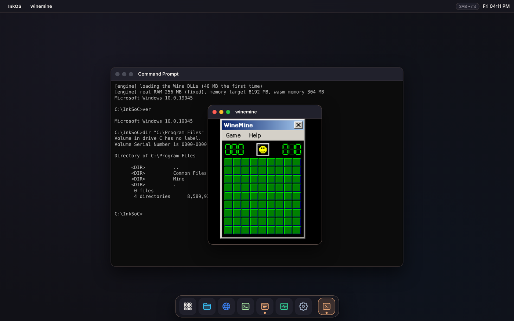
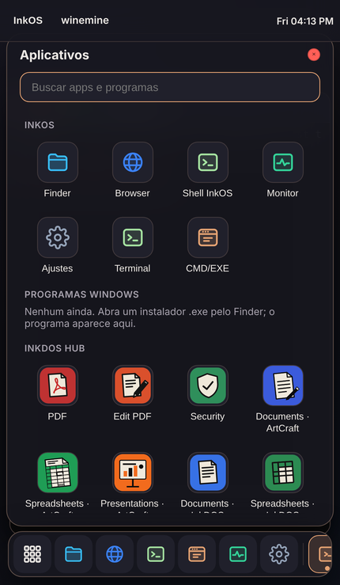
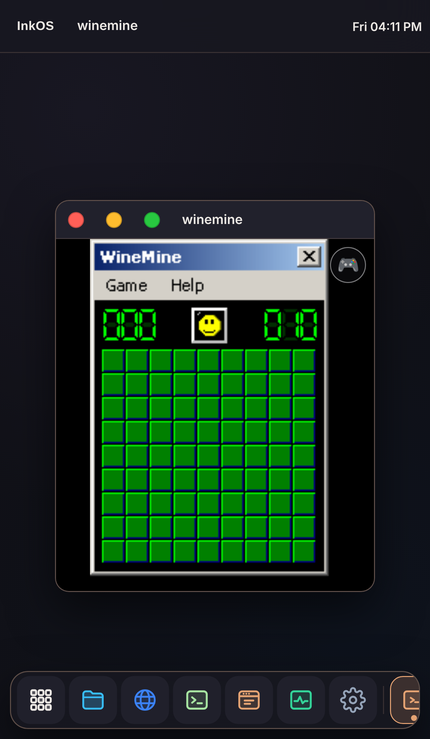
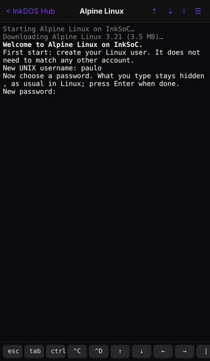

# InkOS

Sistema operacional web experimental em **Rust / WebAssembly** com interface desktop (**InkOS Desktop**), integrado aos aplicativos do **InkDOS Hub**.

🔗 **Acesse online:** [https://inkos-5k7.pages.dev](https://inkos-5k7.pages.dev)

<p align="center"></p>
<p align="center">  </p>

---

## Recursos Principais

- **Kernel & Runtime WebAssembly (`InkSoC`):** compilado em Rust (`wasm32-unknown-unknown`) com suporte a `SharedArrayBuffer` e isolamento de origem (`Cross-Origin-Opener-Policy` / `Cross-Origin-Embedder-Policy`).
- **Gerenciador de Janelas (`WindowManager`):** janelas arrastáveis, redimensionáveis em 8 direções, botões de semáforo estilo macOS (fechar, minimizar, maximizar). A janela de um programa Windows se ajusta ao tamanho da janela dele.
- **Dock estilo macOS:** ícones ampliam ao passar o mouse, nome em balão, pulo ao abrir e um ícone por janela aberta.
- **Aplicativos:** lista como a do Windows/macOS, em três seções: InkOS, Programas Windows (os instalados no drive C:) e InkDOS Hub. Tem busca.
- **Menu InkOS:** Sobre, Ajustes, Teclas, Tema, Tela cheia, Recarregar e **Voltar ao InkDOS Hub**.
- **Sistema de Arquivos Virtual (`VFS`):** armazenamento persistente no navegador via **OPFS** / **IndexedDB** integrado ao **Finder** e aos aplicativos do **InkDOS Hub**.
- **Aplicativos Nativos:**
  - **Finder:** gerenciamento de pastas/arquivos, importação/exportação e envio direto de arquivos para os apps do Hub.
  - **Terminal:** Alpine Linux de verdade (InkShell, no motor InkSoC), com `apk` e internet.
  - **CMD/EXE:** `cmd.exe` e programas `.exe`/`.msi` no motor InkSoC; cada programa ganha sua janela. Arquivos grandes (instaladores de centenas de MB) vão do Finder ao motor sem serem copiados para a memória.
  - **Shell InkOS:** comandos do VFS, sessões `.inkos` e ferramentas de arquivo (Apps → Shell InkOS).
  - **Monitor de Sistema:** acompanhamento em tempo real de FPS, memória, armazenamento e processos/janelas ativas.
  - **Configurações:** seleção de planos de fundo (nativos ou imagem local/VFS), temas (**Mocha / Latte**), cor de destaque e escala da Dock.

---

## Como funciona

- **Boot em dois perfis.** Com isolamento de origem (`crossOriginIsolated`), o kernel usa memória compartilhada e um worker de swap (perfil `mt`, selo "SAB • mt"). Sem isolamento, cai para o perfil compatível `st`. A memória começa em 16 MiB e cresce até 512 MiB (1 GiB com `?mem=1g`).
- **Swap em OPFS.** Um paginador CLOCK em Rust decide o que sai da memória; um worker grava as páginas num arquivo OPFS.
- **Sessões `.inkos`.** "Congelar" salva a sessão num arquivo criptografado (AES-GCM-256, chave derivada da senha por PBKDF2-SHA256). O arquivo inteiro é verificado antes de restaurar. Formato em `docs/INKOS-FORMAT.md`.
- **Apps do Hub por referência.** A lista de apps vem do registry do InkDOS Hub; cada app abre num iframe do próprio Hub. Tema e arquivos vão pelo protocolo `docs/PROTOCOL.md`. Ver `docs/ECOSYSTEM.md`.
- **Offline.** Depois da primeira visita, o service worker guarda o InkOS inteiro; ele abre sem internet. Os apps do Hub precisam da cópia offline do próprio Hub.
- **Toque e iPad/iPhone.** Toque com dois dedos e toque longo abrem o menu de contexto; barra de teclas com Esc, Tab, Ctrl, Opt, Cmd e setas.
- **Ferramentas de arquivo no Shell InkOS.** `search`, `rename` e `sync` (com `--preview` para ver antes de mudar).

## Build e testes

```sh
npm run build        # Rust -> Wasm, verifica o módulo, gera dist/
npm run test:unit    # testes de formato, protocolo e ferramentas
npm run test:e2e     # Playwright (Chromium) contra dist/ com headers de produção
npm run serve        # serve dist/ em http://127.0.0.1:8787 com COOP/COEP
```

`scripts/verify-wasm.sh` falha o build se o navegador não aceitar o `.wasm` (foi a causa do erro de parse em produção, ver `reports/`).

## Estrutura do Projeto

```text
├── inkos/
│   ├── Cargo.toml          # Crate Rust do kernel Wasm
│   ├── src/                # Kernel Rust (memória, paginador de swap)
│   └── web/                # Desktop: index.html, sw.js, theme/, js/ (wm, vfs, kernel, swap, session, appload, protocol, mobile, tools, apps/)
├── bench/                  # Kernels do InkBench (Rust) e comparação wasm vs nativo
├── docs/                   # Formato .inkos, protocolo, ecossistema, ADRs
├── tests/                  # Testes unitários e E2E
├── reports/                # Relatórios do autopilot
└── scripts/                # build.sh, verify-wasm.sh, gen-sw.mjs, sync-registry-snapshot.sh
```

## Licença

MIT. Dependências em `THIRD_PARTY_LICENSES.md`.

## Limites conhecidos

- Testado só no Chromium (headless). Safari, iPhone e iPad ainda precisam ser testados à mão: `reports/DEVICE-CHECKLIST.md`.
- Alguns apps do Hub ainda não seguem o tema do InkOS (suíte InkDOS, Terminal, CMD/EXE).
- Instaladores NSIS como o do Steam podem travar na última página do motor InkSoC, e o cliente Steam (Chromium/CEF) não roda. Ver o README do InkSoC.
- Drive C: do InkSoC e a home do Linux ficam no armazenamento do Hub, não no VFS do InkOS: arquivos entram pelo Finder (Abrir / Enviar ao Terminal).
- Deploy: o Cloudflare Pages publica cada branch como preview; produção atualiza com o merge em `main`.
